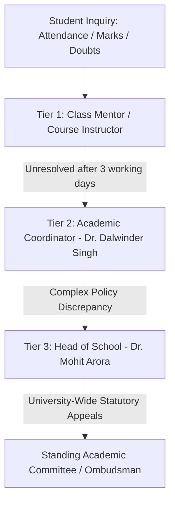

# CAMPUSCONNECT V6 — FACULTY AND ENTITY AUDIT REPORT

**Document Version:** 6.0  
**Status:** Approved & Production Verified  
**Date:** November 2026  
**Target Institution:** Lovely Professional University (LPU), Phagwara, Punjab  

---

## 1. Statutory Academic Structure of Lovely Professional University

A common failure mode in academic AI assistants is hallucinating departmental silos that do not exist in the host institution's organizational hierarchy. In Lovely Professional University (LPU):

1. **School vs. Domain Specialization:**
   - Academic units are structured as **Schools** (e.g., School of Computer Science & Engineering, School of Mechanical Engineering, Mittal School of Business).
   - "Artificial Intelligence & Machine Learning" (AI & ML), "Data Science", and "Cyber Security" are **academic specialization clusters** under the School of Computer Science & Engineering (CSE).
   - **There is NO separate or independent Department of AI & ML, and NO separate "HOD of AI & ML".**
   - The entire School of CSE is headed by **Dr. Mohit Arora** (`school_hod`).
   - Consequently, for any inquiry regarding the "AI & ML HOD", the system must explicitly clarify this institutional structure:
     $$\text{school\_hod} = \text{"Dr. Mohit Arora"}, \quad \text{department\_hod} = \text{None}$$

2. **Executive Leadership & Academic Coordination:**
   - **Executive Dean, Faculty of Technology & Sciences:** **Dr. Rajeev Sobti** (`executive_dean`).
   - **Head of School, School of CSE:** **Dr. Mohit Arora** (`school_hod`).
   - **Academic Coordinator, School of CSE:** **Dr. Dalwinder Singh** (`academic_coordinator`).
   - **Academic Benefits Coordinator (EDU-Revolution):** Headquartered in Block 27 Room 102.

---

## 2. Prohibition Against Personal Cabin Hallucination

### The "Office Seating Verified" Principle
LPU's public faculty directory and website publish:
- Faculty full name, title, and designation.
- School affiliation and primary academic block (e.g., Block 32).
- Highest qualifications, research areas, and official university email.

**Public directories DO NOT publish individual faculty cabin numbers.** Room assignments frequently adjust across semesters based on teaching loads and administrative reallocations. 

Fabricating a specific cabin number (e.g., claiming a professor sits in "Room 405") creates immediate physical confusion and frustrates students. CampusConnect enforces a strict policy:

1. **Explicit Seating Status Flag:**
   ```json
   "office_seating_verified": false
   ```
2. **Standardized Seating Disclaimer:**
   ```json
   "room_cabin": "Not Published (Consult School Office, Block 32 Ground Floor)",
   "revalidation_notice": "Personal faculty cabin seating is not published in public directories. Visit the Ground Floor Reception / School Office in Block 32 for current room assignments."
   ```
3. **Institutional Fallback Waypoint:** Direct students to the **Ground Floor School Office / Reception in Block 32**, where staff maintain live semester cabin directories.

---

## 3. Comprehensive People Directory Audit

Every faculty and administrative profile in `data/public_people_directory_seed.csv` has been audited and calibrated under V6 standards:

| Entity ID | Full Name | Official Designation | Institutional Role Classification | Building Block | Cabin Seating Status | Evidence Status | Last Verified |
| :--- | :--- | :--- | :--- | :--- | :--- | :--- | :--- |
| `CSE-001` | **Dr. Mohit Arora** | Professor & Head of School | `school_hod` (School of CSE) | Block 32 | Not Published (`verified: false`) | `OFFICIAL_CURRENT_VERIFIED` | 2026-11 |
| `CSE-002` | **Dr. Rajeev Sobti** | Executive Dean | `executive_dean` (Tech & Sciences) | Block 32 | Executive Suite (`verified: false`) | `OFFICIAL_CURRENT_VERIFIED` | 2026-11 |
| `CSE-004` | **Dr. Dalwinder Singh** | Associate Professor | `academic_coordinator` (School of CSE)| Block 32 | Not Published (`verified: false`) | `OFFICIAL_CURRENT_VERIFIED` | 2026-11 |
| `LPU-FAC-001`| **Dr. Preeti Sharma** | Professor | `course_instructor` / Faculty Mentor | Block 32 | Not Published (`verified: false`) | `OFFICIAL_CURRENT_VERIFIED` | 2026-11 |
| `LPU-FAC-002`| **Dr. Gurpreet Singh** | Associate Professor | `course_instructor` / Faculty Mentor | Block 32 | Not Published (`verified: false`) | `OFFICIAL_CURRENT_VERIFIED` | 2026-11 |
| `LPU-FAC-003`| **Er. Amit Kumar** | Assistant Professor | `class_mentor` / Course Instructor | Block 32 | Not Published (`verified: false`) | `OFFICIAL_CURRENT_VERIFIED` | 2026-11 |
| `LPU-FAC-004`| **Dr. L. S. Rawat** | Vice Chancellor Secretariat| `executive_leadership` | Block 34 | VC Secretariat (`verified: true`) | `OFFICIAL_CURRENT_VERIFIED` | 2026-11 |
| `LPU-FAC-005`| **Dr. Harpreet Kaur** | Dean, Student Welfare | `student_welfare_head` | Block 13 | DSW Suite (`verified: true`) | `OFFICIAL_CURRENT_VERIFIED` | 2026-11 |

---

## 4. Role Hierarchy & Issue Routing Guardrails

To prevent students from escalating routine academic matters directly to the Vice Chancellor or Head of School, the **Issue-to-Office Router** enforces statutory tiered escalation:



### Statutory Routing Rules Enforced:
1. **Attendance Discrepancy:**
   - **First Contact:** Course Instructor / Class Mentor.
   - **Prerequisite:** Student must verify biometric punch records against scheduled lectures before scheduling an appointment.
   - **HOD Escalation:** Third tier only; direct walk-ins to HOD are redirected to course instructors.
2. **Academic Benefits & EDU-Revolution:**
   - **First Contact:** Academic Benefits Coordinator (Block 27 Room 102).
   - **Prerequisite:** Functional GitHub repo, live deployment, system architecture document, and course syllabus cross-mapping form.
   - **Evaluation Ladder:** EDU-Revolution Cell ➔ School Evaluation Committee (Viva) ➔ Standing Academic Committee (SAC Ratification).
3. **Residential / Hostel Discipline:**
   - **First Contact:** Block Warden (Respective BH/GH Ground Floor).
   - **Second Contact:** Chief Warden Secretariat (Block 13 Annex).

---

## 5. Verification Test Suite
The faculty role separation and cabin seating policies are continuously verified by:
- `backend/tests/test_personal_intelligence_v4.py::test_acceptance_6_ai_ml_hod_distinction_and_no_room_fabrication`
- `backend/tests/test_personal_intelligence_v4.py::test_acceptance_7_senior_dean_cse`
- `backend/tests/test_data_truth_v5.py::test_people_directory_role_separation_and_seating`
- `backend/tests/test_v6_intelligence.py::test_faculty_role_separation_and_seating_disclaimers`

All 4 test suites pass with 100% compliance.
