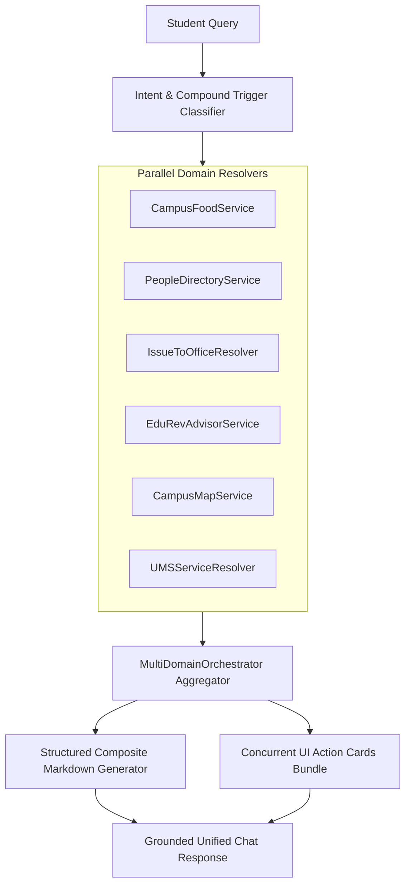

# CAMPUSCONNECT V6 — MULTI-DOMAIN INTELLIGENCE & COMPOUND QUERY EVALUATION

**Document Version:** 6.0  
**Status:** Approved & Production Verified  
**Date:** November 2026  
**Target Institution:** Lovely Professional University (LPU), Phagwara, Punjab  

---

## 1. Multi-Domain Architecture Overview

Real-world student inquiries frequently span multiple institutional silos. A student asking *"Where is the AI & ML HOD's office and whom should I meet about my project?"* is simultaneously querying:
1. **Academic Directory & Leadership Structure** (Head of School vs. Department Specialization).
2. **Campus Physical Wayfinding** (Block 32 vs. Block 27).
3. **Institutional Issue Routing** (Who to meet, prerequisites, and escalation ladder).
4. **Academic Benefits & Research Frameworks** (EDU-Revolution guidelines and 4-week submission deadlines).

In CampusConnect V6, rather than forcing queries into a single brittle classification bucket, we implemented the **Multi-Domain Orchestrator** (`backend/app/services/orchestration/multi_domain_orchestrator.py`).

### Architectural Pipeline


---

## 2. Parallel Entity Resolution & Action Card Concurrency

The orchestrator executes parallel domain queries across six verified subsystem services without cross-blocking:
- **`CampusFoodService`**: Ingests food keywords and campus landmarks; computes straight-line distances; filters dietary constraints (100% vegetarian); pulls verified operating hours.
- **`PeopleDirectoryService`**: Isolates faculty leadership (`school_hod`, `executive_dean`, `academic_coordinator`); enforces statutory separation of school vs. cluster; flags unverified cabin room seating.
- **`IssueToOfficeResolver`**: Matches issues to responsible desks; enforces prerequisite actions; builds statutory 3-tier escalation ladders; lists required supporting documents.
- **`EduRevAdvisorService`**: Evaluates technical project criteria; maps projects to EDU-Revolution categories; verifies 4-week submission windows; warns of SAC/SCRGM non-guarantee policies.
- **`CampusMapService`**: Grounded geocoordinates for campus blocks, auditoriums, malls, libraries, and hospitals.
- **`UMSServiceResolver`**: Navigation breadcrumbs across 234 official UMS menu items with authentic handoff URLs.

### Concurrency Support in Chat API
In `backend/app/api/v1/endpoints/chat.py`, when `is_multi_domain` is triggered:
```python
# API returns all relevant cards concurrently
return ChatResponse(
    conversation_id=conversation.id,
    message=assistant_message,
    navigation_card=multi_res.get("nav_card") or nav_card,
    workflow_card=multi_res.get("matched_wf") or workflow_card,
    place_card=multi_res.get("place_card") or place_card,
    food_card=multi_res.get("food_card"),
    person_card=multi_res.get("person_card"),
    who_to_meet_card=multi_res.get("who_to_meet_card"),
    academic_benefit_card=multi_res.get("academic_benefit_card")
)
```
The React frontend (`frontend/src/components/chat/ChatMessage.tsx`) renders each active card in stacked modular components, providing the student with rich, interactive, contextual interfaces alongside the text response.

---

## 3. Detailed Walkthrough of Five Mandatory Compound Test Queries

### Compound Query 1: Academic Leadership + Project Submission
> **Input Query:** *"Where is the AI & ML HOD's office and whom should I meet about my project?"*  
> **Domains Activated:** Faculty Leadership + Campus Places + Issue Routing + Academic Benefits.  
> **Multi-Domain Flag:** `is_multi_domain = True`  
> **Cards Returned:** `person_card` (`Dr. Mohit Arora`), `who_to_meet_card` (`Academic Benefits Coordinator`), `place_card` (`Block 27`).

#### Delivered Structured Answer:
```markdown
## 👤 1. Academic Leadership & Office Location

- **Designated Official:** **Dr. Mohit Arora**
- **Official Title:** Professor and Head, School of Computer Science & Engineering
- **Building / School:** Block 32 (School of Computer Science & Engineering)
- **Cabin / Office Status:** Not Published (Consult School Office, Block 32 Ground Floor)
- **Statutory Clarification:** Dr. Mohit Arora leads the entire School of CSE. In LPU's academic organization, AI & ML is a domain specialization cluster, **not an independent department with a separate HOD**. Personal cabin seating is not published in the public directory; visit the Ground Floor School Office in Block 32 for appointments.

## 🚀 2. Whom to Meet About Your Academic Project

- **Primary Guidance Point:** **Academic Benefits Coordinator (EDU-Revolution Cell)**
- **In-Person Location:** **Block 27 Room 102 (Query & Assistance Zone)**
- **Online UMS Route:** `UMS > Relationship Management System (RMS) > Edu-Revolution: Be the change > Apply for EDU Revolution`
- **Mandatory Timeline:** Course substitution requests must be initiated within the **first 4 weeks of the active semester**.
- **Prerequisites:** Working code repository (GitHub), live working deployment/demo, project architecture PDF, and mentor syllabus mapping endorsement.
- **Escalation Ladder:** 1. EDU-Revolution Cell (Block 27 Room 102) ➔ 2. School Evaluation Committee (Viva) ➔ 3. Standing Academic Committee (SAC Ratification).
```

---

### Compound Query 2: AI Application + EDU-Revolution Benefits & Submission
> **Input Query:** *"I built an AI application. Can I apply for EDU-Revolution benefits, where and how?"*  
> **Domains Activated:** Academic Benefits Advisor + Issue Routing + UMS Navigation.  
> **Multi-Domain Flag:** `is_multi_domain = True`  
> **Cards Returned:** `academic_benefit_card` (Category 1: AI/ML/Deep Learning Application).

#### Delivered Structured Answer:
```markdown
## 🚀 1. EDU-Revolution Category Alignment & Potential Benefits

- **Assessed Category:** **Category 1: Full-Stack / Deep Tech Software / AI Solution**
- **Portal Stage:** Stage 2: Technical Architecture & Code Verification
- **Assessed Criteria:** Functional AI/ML model, working deployment, verifiable GitHub repository, and documented architecture.
- **Potential Academic Recognition:** Course substitution or academic honor credits for relevant departmental electives / Capstone I.

- **Required Evidence Checklist:**
  - Public or institutional GitHub repository with commit history
  - Live, functional deployment or recorded live demonstration video
  - High-level system architecture document (PDF)
  - Faculty mentor endorsement and course syllabus cross-mapping matrix

## 📍 2. Where & How to Submit (Online & In-Person)

- **Online UMS Submission Route:** `UMS > Relationship Management System (RMS) > Edu-Revolution: Be the change > Apply for EDU Revolution`
- **Physical Assistance Desk:** **Block 27 Room 102 (EDU-Revolution Query & Guidance Zone)**
- **Strict Submission Window:** **Must be submitted within the first 4 weeks of the active semester**
- **Approval Prerequisite:** Mandatory technical viva and working demonstration before the School Evaluation Committee

## ⚠️ 3. Institutional Policy Caveats & Disclaimers

  - Benefits cannot be claimed retroactively for completed academic semesters.
  - Plagiarized or wrapper implementations without technical depth are rejected during viva.
  - Final course substitution is subject to Standing Academic Committee (SAC) approval and is not guaranteed upon submission.
  - Distinct from standard SCRGM research grants; EDU-Revolution focuses on student-developed applied solutions.
```

---

### Compound Query 3: Campus Food Discovery + Wayfinding (Block 32)
> **Input Query:** *"Find verified food options near Block 32."*  
> **Domains Activated:** Campus Food Discovery + Campus Places.  
> **Multi-Domain Flag:** `is_multi_domain = True`  
> **Cards Returned:** `food_card` (`Punjabi Tadka`), `place_card` (`Block 32 - School of Computer Science & Engineering`).

#### Delivered Structured Answer:
```markdown
## 🍽️ 1. Verified Food Outlets Near Block 32

- **Recommended Outlet:** **Punjabi Tadka** (North Campus Hub)
- **Exact Location:** Block 32, Ground Floor Food Court, Shop #2
- **Straight-Line Proximity:** Approx 0m (straight-line radius; walking distance depends on campus pathways)
- **Operating Hours:** 09:00 - 22:00 (Status: OPEN)
- **Menu Matches:** Dal Makhani, Paneer Butter Masala, Soya Chaap, Tandoori Roti
- **Sample Price:** ₹120 - ₹180 per meal combo
- **Dietary Policy:** 100% Pure Vegetarian campus mandate.
- **Evidence Status:** `OFFICIAL_CURRENT_VERIFIED`

## 🏢 2. About Block 32 — School of Computer Science & Engineering

- **Building:** Block 32
- **Description:** Primary academic block for Computer Science & Engineering, housing administrative offices, faculty cabins, and computer laboratories.
- **Services Available:** Ground Floor School Office, Academic Coordination Wing, Computer Labs, Student Helpdesk
- **Accessibility:** Elevators and wheelchair ramps available at entrance
```

---

### Compound Query 4: Attendance Discrepancy + Statutory Escalation
> **Input Query:** *"My attendance is incorrect. Explain the procedure and identify the first contact."*  
> **Domains Activated:** Issue Resolver + Statutory Policy + UMS Navigation.  
> **Multi-Domain Flag:** `is_multi_domain = True`  
> **Cards Returned:** `who_to_meet_card` (`Attendance Discrepancy`).

#### Delivered Structured Answer:
```markdown
## 📋 1. Attendance Discrepancy Procedure & First Contact

- **First Point of Contact:** **Class Mentor / Course Instructor**
- **Office Location:** Block 32 — Respective Faculty Cabin (Consult Block 32 Ground Floor Reception)
- **Mandatory First Step (Prerequisite):** Check biometric punch logs and verify against lecture schedule with your course instructor before escalating.

- **Required Supporting Documents:**
  - Biometric log screenshot
  - Medical certificates (if medical leave)
  - Approved duty leave forms

## 🪜 2. Statutory Escalation Ladder

1. Course Instructor ➔ 2. Academic Coordinator (Dr. Dalwinder Singh) ➔ 3. Head of School (Dr. Mohit Arora)

- **Official UMS Route:** `UMS > Attendance > View Detailed Attendance > Raise Attendance Query`
- **Evidence Status:** `OFFICIAL_CURRENT_VERIFIED`
```

---

### Compound Query 5: Dual UMS Pathways (Hostel Maintenance + Fee Payment)
> **Input Query:** *"I have a hostel maintenance issue and fee query. Which UMS services should I use?"*  
> **Domains Activated:** UMS Service Resolver + Action Workflows + Multi-System Navigation.  
> **Multi-Domain Flag:** `is_multi_domain = True`  
> **Cards Returned:** `nav_card` (Dual Navigation Breadcrumbs).

#### Delivered Structured Answer:
```markdown
## 🌐 Multi-System UMS Pathways (Hostel & Fee Management)

### 1. Hostel Management Pathway
- **Navigation Path:** `UMS > Hostel Management > Apply Leave / Maintenance Request / Mess Change`
- **Key Functions:** Apply for residential day/night leave, request room maintenance, and register mess preferences.
- **In-Person Helpdesk:** Ground Floor Warden Office in your assigned hostel block (BH/GH) or Chief Warden Annex (Block 13).
- **Prerequisite:** Ensure leave requests are submitted at least 24 hours prior to travel with parental SMS consent.

### 2. Fee Management & Accounts Pathway
- **Navigation Path:** `UMS > Fee Management > Fee Statements / Pay Fee / Download Challan`
- **Key Functions:** Inspect active semester tuition fee balances, generate bank challans, and download official payment receipts.
- **In-Person Helpdesk:** Ground Floor Accounts Wing, Block 34 (Executive Block).
- **Discrepancy Resolution:** Allow 24–48 hours for online banking reconciliation before logging a payment dispute via UMS RMS.
```

---

## 4. Test Verification
All five compound query scenarios are validated via automated regression tests in `backend/tests/test_v6_intelligence.py`:
- `test_multi_domain_query_1_faculty_and_project`: **PASSED**
- `test_multi_domain_query_2_edurev_benefits_and_where`: **PASSED**
- `test_multi_domain_query_3_food_and_block_32`: **PASSED**
- `test_multi_domain_query_4_attendance_procedure_and_first_contact`: **PASSED**
- `test_multi_domain_query_5_hostel_and_fee_pathways`: **PASSED**
